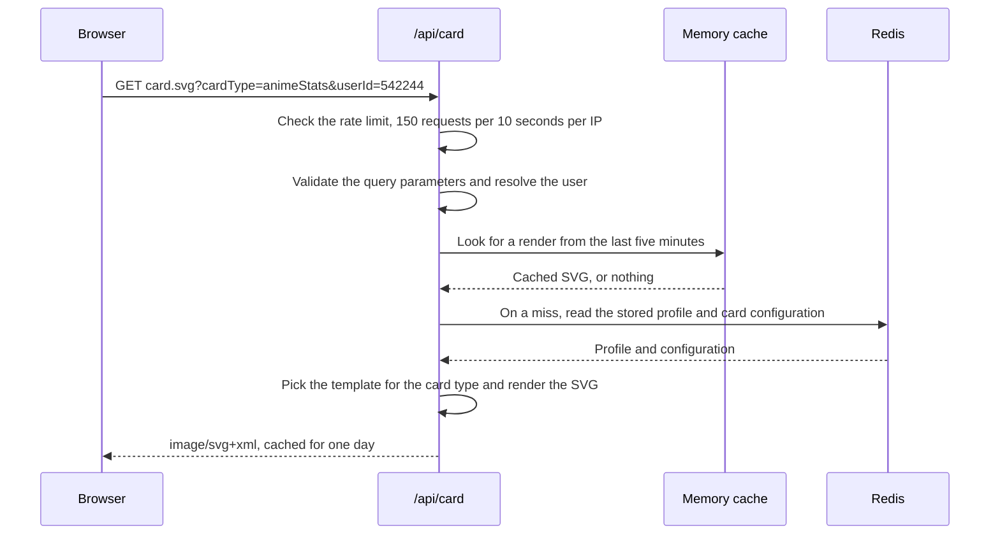

# AniCards

[](https://github.com/RLAlpha49/AniCards/actions/workflows/ci.yml)
[](https://github.com/RLAlpha49/AniCards/actions/workflows/security-audits.yml)
[](https://github.com/RLAlpha49/AniCards/actions/workflows/check-updates.yml)
[](LICENSE)

AniCards turns a public [AniList](https://anilist.co) profile into image cards of its stats. You pick a card type, choose colours, and take the result as an SVG link or a PNG or WebP file. There is nothing to install and no account to create.

**[Open AniCards](https://anicards.alpha49.com)**

<a href="https://anicards.alpha49.com/generator">
<picture>
  <source media="(prefers-color-scheme: dark)" srcset="https://api.anicards.alpha49.com/card.svg?cardType=animeStats&userId=542244&variation=default&colorPreset=anilistDark">
  
</picture>
</a>

<details>
<summary>Contents</summary>

- [What you can make](#what-you-can-make)
- [Make your first card](#make-your-first-card)
- [Link to a card directly](#link-to-a-card-directly)
- [Card types](#card-types)
- [Common questions](#common-questions)
- [Development](#development)
- [Contributing](#contributing)
- [License](#license)

</details>

## What you can make

AniCards draws 54 card types from the public numbers on an AniList profile. They fall into six groups:

| Group | What it covers |
| --- | --- |
| Core Stats | Anime and manga totals, profile details, social counts |
| Anime Deep Dive | Genres, tags, studios, voice actors, staff, and distributions |
| Manga Deep Dive | Genres, tags, staff, and distributions |
| Activity & Engagement | Heatmaps, streaks, recent activity, review counts |
| Library & Progress | Favourites, milestones, backlogs, and what you are watching now |
| Advanced Analytics | Anime and manga compared side by side |

Most cards come in several variations. Genres, for example, can be a list, a pie chart, a donut chart, a bar chart, or a radar chart. The [examples page](https://anicards.alpha49.com/examples) shows every card type with a live preview drawn from a real profile.

## Make your first card

1. Open the [generator](https://anicards.alpha49.com/generator).
2. Type your AniList username. The generator reads public profile data only, so it never asks for a password.
3. Pick a palette. There are 55 named presets, or you can set the four colours yourself.
4. Choose the cards you want and a variation for each.
5. Generate. The finished set opens on a page you can return to, download, or share.

The generator saves your cards against your AniList profile, so the same set stays available at `anicards.alpha49.com/user?username=YourName`. Running the generator again adds the new selection to the set; cards you already saved stay in it.

### Download the cards

Each card downloads on its own as PNG or WebP. The set page also has a bulk download that converts every card and packs the files into one zip archive.

### Put a card on your AniList profile

AniList draws an image from a single line of text in your profile's About field. Copy a card's About line from its copy menu and paste it into the editor. AniList draws the card 150 pixels wide, which is why the card layouts keep their numbers large.


The copy menu also gives you the plain SVG link, which works anywhere that accepts an image URL: a GitHub README, a forum signature, a personal site.

## Link to a card directly

Every card has an address. You do not need the generator to build one.

```text
https://api.anicards.alpha49.com/card.svg?cardType=animeStats&userId=542244&colorPreset=anilistDark
```

That URL returns an SVG image. Drop it into Markdown, HTML, or any field that accepts an image link.

### Card URL parameters

| Parameter | Required | What it does |
| --- | --- | --- |
| `cardType` | Yes | Card to draw, for example `animeStats` or `mangaGenres`. See [card types](#card-types). |
| `userId` | One of these | AniList numeric user ID, for example `542244`. |
| `userName` | One of these | AniList username, for example `Alpha49`. If you send both, `userId` wins. |
| `variation` | No | Layout to use. Valid values depend on the card type. An unknown value falls back to the card's default layout. |
| `colorPreset` | No | Named palette, for example `anilistDark` or `sunset`. Use `custom` to draw from the configuration saved on the server, which brings its colours and its variation. |
| `titleColor`, `backgroundColor`, `textColor`, `circleColor` | No | Individual colour overrides. |
| `borderColor` | No | Border stroke colour. |
| `borderRadius` | No | Corner radius in pixels, from 0 to 100. |
| `showFavorites` | No | `true` or `false`. Adds favourite hearts to voice actor, studio, and staff cards. |
| `statusColors` | No | `true` or `false`. Uses fixed colours for status distribution cards. |
| `piePercentages` | No | `true` or `false`. Prints a percentage on each slice of a pie or donut chart. |
| `gridCols`, `gridRows` | No | Grid size for `favoritesGrid`, from 1 to 5. Defaults to 3. |
| `_t` | No | Cache buster. Its presence asks the server to draw the card fresh instead of using a stored copy. The value is ignored, so `_t=1` and `_t=2` do the same thing. |

> [!WARNING]
> URL-encode the `#` in a hex colour as `%23`. `titleColor=#ff0000` breaks the query, and `titleColor=%23ff0000` works. Colours take three, six, or eight hex characters. A colour name such as `red` is ignored.

### Examples

Anime stats with the AniList dark palette:

```text
https://api.anicards.alpha49.com/card.svg?cardType=animeStats&userName=Alpha49&colorPreset=anilistDark
```

Genre donut chart with custom colours:

```text
https://api.anicards.alpha49.com/card.svg?cardType=animeGenres&userId=542244&variation=donut&colorPreset=anilistDark&titleColor=%23ff0000&backgroundColor=%230b1622&piePercentages=true
```

A five by five favourites grid:

```text
https://api.anicards.alpha49.com/card.svg?cardType=favoritesGrid&userId=542244&variation=anime&gridCols=5&gridRows=5&colorPreset=sunset
```

The same URLs also work without the `/api` prefix, on either host: `anicards.alpha49.com/card.svg` and `api.anicards.alpha49.com/card.svg` both render a card.

### Colour presets

There are 55 named presets. Use the preset name exactly as written. Nineteen of them use gradients, and the generator lists all 55 with previews.

<details>
<summary>List all 55 presets</summary>

- **Dark:** `default`, `anilistDark`, `anilistDarkGradient`, `aurora`, `arcticAurora`, `citrus`, `cosmicNebula`, `cyberpunk`, `darkModeBlue`, `emberGlow`, `fireEmber`, `forestDepth`, `galaxy`, `goldStandard`, `goldenHour`, `midnight`, `neonGlow`, `oceanWaves`, `polarNight`, `purpleDusk`, `purpleHaze`, `redAlert`, `seafoam`, `stardust`, `sunsetGradient`, `synthwave`, `twilight`, `twilightSky`, `verdantTwilight`
- **Light:** `anilistLight`, `anilistLightGradient`, `bubblegum`, `canyonSunrise`, `cherryBlossom`, `coral`, `coralReef`, `earthyGreen`, `fire`, `forest`, `lavender`, `lavenderBloom`, `mint`, `mintFresh`, `monochromeGray`, `ocean`, `oceanBreeze`, `pastelDreams`, `rainforestMist`, `rosegold`, `skylineAzure`, `solarizedLight`, `springGarden`, `sunriseMeadow`, `sunset`, `vintageSepia`

</details>

## Card types

Each card has a `cardType` ID and one or more variations. The generator offers the same list, with a live preview for each variation.

<details>
<summary>List all 54 card types</summary>

### Core Stats

- **Anime Statistics** (`animeStats`): `vertical`, `default`, `compact`, `minimal`
- **Manga Statistics** (`mangaStats`): `vertical`, `default`, `compact`, `minimal`
- **Social Statistics** (`socialStats`): `default`, `compact`, `minimal`, `badges`
- **Profile Overview** (`profileOverview`): `default`, `compact`, `minimal`
- **Anime vs Manga Overview** (`animeMangaOverview`): `default`

### Anime Deep Dive

- **Anime Genres** (`animeGenres`): `default`, `pie`, `donut`, `bar`, `radar`
- **Anime Tags** (`animeTags`): `default`, `pie`, `donut`, `bar`, `radar`
- **Voice Actors** (`animeVoiceActors`): `default`, `pie`, `donut`, `bar`
- **Animation Studios** (`animeStudios`): `default`, `pie`, `donut`, `bar`
- **Anime Staff** (`animeStaff`): `default`, `pie`, `donut`, `bar`
- **Anime Status Distribution** (`animeStatusDistribution`): `default`, `pie`, `donut`, `bar`
- **Anime Format Distribution** (`animeFormatDistribution`): `default`, `pie`, `donut`, `bar`
- **Anime Source Material Distribution** (`animeSourceMaterialDistribution`): `default`, `pie`, `donut`, `bar`
- **Anime Seasonal Preference** (`animeSeasonalPreference`): `default`, `pie`, `donut`, `bar`, `radar`
- **Anime Country Distribution** (`animeCountry`): `default`, `pie`, `donut`, `bar`
- **Anime Score Distribution** (`animeScoreDistribution`): `default`, `horizontal`, `cumulative`
- **Anime Year Distribution** (`animeYearDistribution`): `default`, `horizontal`
- **Episode Length Preferences** (`animeEpisodeLengthPreferences`): `default`, `pie`, `donut`, `bar`
- **Genre Synergy** (`animeGenreSynergy`): `default`

### Manga Deep Dive

- **Manga Genres** (`mangaGenres`): `default`, `pie`, `donut`, `bar`, `radar`
- **Manga Tags** (`mangaTags`): `default`, `pie`, `donut`, `bar`, `radar`
- **Manga Staff** (`mangaStaff`): `default`, `pie`, `donut`, `bar`
- **Manga Status Distribution** (`mangaStatusDistribution`): `default`, `pie`, `donut`, `bar`
- **Manga Format Distribution** (`mangaFormatDistribution`): `default`, `pie`, `donut`, `bar`
- **Manga Country Distribution** (`mangaCountry`): `default`, `pie`, `donut`, `bar`
- **Manga Score Distribution** (`mangaScoreDistribution`): `default`, `horizontal`, `cumulative`
- **Manga Year Distribution** (`mangaYearDistribution`): `default`, `horizontal`

### Activity & Engagement

- **Activity Heatmap** (`activityHeatmap`): `default`, `github`, `fire`
- **Recent Activity Summary** (`recentActivitySummary`): `default`
- **Recent Activity Feed** (`recentActivityFeed`): `default`
- **Activity Streaks** (`activityStreaks`): `default`
- **Top Activity Days** (`topActivityDays`): `default`
- **Social Milestones** (`socialMilestones`): `default`
- **Review Statistics** (`reviewStats`): `default`
- **Seasonal Viewing Patterns** (`seasonalViewingPatterns`): `default`

### Library & Progress

- **Favourites Summary** (`favoritesSummary`): `default`, `compact`, `minimal`
- **Favourites Grid** (`favoritesGrid`): `anime`, `manga`, `characters`, `staff`, `studios`, `mixed`
- **Status Completion Overview** (`statusCompletionOverview`): `combined`, `split`
- **Consumption Milestones** (`milestones`): `default`
- **Personal Records** (`personalRecords`): `default`
- **Planning Backlog** (`planningBacklog`): `default`
- **Most Rewatched/Reread** (`mostRewatched`): `default`, `anime`, `manga`
- **Currently Watching / Reading** (`currentlyWatchingReading`): `default`, `anime`, `manga`
- **Dropped Media** (`droppedMedia`): `default`

### Advanced Analytics

- **Anime vs Manga Score Comparison** (`scoreCompareAnimeManga`): `default`
- **Country Diversity** (`countryDiversity`): `default`
- **Genre Diversity** (`genreDiversity`): `default`
- **Format Preference Overview** (`formatPreferenceOverview`): `default`
- **Release Era Preference** (`releaseEraPreference`): `default`
- **Start-Year Momentum** (`startYearMomentum`): `default`
- **Length Preference** (`lengthPreference`): `default`
- **Tag Category Distribution** (`tagCategoryDistribution`): `default`
- **Tag Diversity** (`tagDiversity`): `default`
- **Studio Collaboration** (`studioCollaboration`): `default`

</details>

Four card types accept `showFavorites`: `animeVoiceActors`, `animeStudios`, `animeStaff`, and `mangaStaff`. Two accept `statusColors`: `animeStatusDistribution` and `mangaStatusDistribution`.

## Common questions

**Do I need an AniList account?** You need a public AniList profile, because the cards are drawn from it. You do not need to sign in to AniCards, and you never give it a password.

**Which data does AniCards read?** Public profile data only: list totals, scores, genres, tags, activity, favourites, and social counts. AniCards reads whatever AniList makes public for that profile, so a profile that hides its lists has little to draw.

**Why do the numbers look old?** Cards are drawn from a stored copy of the profile, not from AniList on every request. A background job refreshes stored profiles on a schedule. The set page shows the date the numbers last changed. To skip the stored render and draw again from the stored data, add `_t` to the card URL.

**How large are the cards?** Sizes vary by card type. Anime statistics in its default layout is 450 by 195 pixels, the vertical layout is 260 by 350, and a favourites grid grows with its column and row count.

**Can I use a card in a GitHub README?** Yes. Paste the card URL into Markdown as an image. The endpoint sends the card as `image/svg+xml`, so it stays sharp at any width.

**What happens when AniList is down?** Card requests are served from a stored copy, so they keep working. Only a refresh waits for AniList to come back.

## Development

AniCards is a Next.js app with TypeScript, Tailwind CSS, and Upstash Redis for storage. Cards are generated server-side as SVG.

### Requirements

- [Bun](https://bun.sh) 1.4 or newer
- [Docker](https://www.docker.com/products/docker-desktop), for the local Redis stack

### Set up locally

1. Clone the repository and install dependencies.

    ```bash
    git clone https://github.com/RLAlpha49/AniCards.git
    cd AniCards
    bun install
    ```

2. Start the local Redis stack.

    ```bash
    bun run db:setup
    ```

    This starts Redis and `serverless-redis-http`, a proxy that speaks the Upstash REST protocol. The app talks to Redis over HTTP, so it cannot connect to a plain Redis container. The proxy listens on `127.0.0.1:8079`.

3. Seed the database with one real profile.

    ```bash
    bun run db:seed
    ```

    The seed script fetches the public AniList profile for `Alpha49` (user ID `542244`) and writes a card configuration for every card type. It needs an internet connection. To clear the local database instead, run `bun run db:reset`.

4. Start the development server.

    ```bash
    bun run dev
    ```

5. Open [http://localhost:3000](http://localhost:3000).

The tracked `.env.development` file points the app at the local Redis proxy, so a fresh clone needs no environment setup. Production values go in `.env.local`; `.env.example` lists every variable with a comment.

### Run everything in Docker

```bash
bun run dev:docker
```

This starts the app and RedisInsight. The app is at [http://localhost:3000](http://localhost:3000), and RedisInsight is at [http://localhost:5540](http://localhost:5540). Connect RedisInsight to `redis:6379`.

To run the browser tests against the Docker stack:

```bash
bun run test:e2e:docker
```

### Commands

| Command | What it does |
| --- | --- |
| `bun run dev` | Start Next.js with Turbopack |
| `bun run build` | Production build |
| `bun run lint` | Run ESLint |
| `bun run typecheck` | Run the TypeScript compiler with no output |
| `bun run format` | Format with Prettier |
| `bun test` | Run unit tests |
| `bun run test:e2e` | Run Playwright tests |
| `bun run db:setup` | Start Redis and the REST proxy |
| `bun run db:seed` | Seed the local database |
| `bun run db:reset` | Delete all local Redis data |
| `bun run update` | Update dependencies with npm-check-updates |

### Project layout

```text
app/                  Routes and API handlers
  api/card/           Card SVG rendering
  api/convert/        SVG to PNG and WebP conversion
  api/cron/           Scheduled refresh endpoints
  generator/          Card generator page
  examples/           Every card type with live previews
  user/               Saved card set for one profile
components/           React components, grouped by page
lib/                  Card generation, storage, and shared helpers
  card-data/          Reading and validating stored profiles
  svg-templates/      One template per card family
  stores/             Storage adapters and in-memory caches
scripts/              Database, QStash, and Redis maintenance scripts
tests/                Unit tests and Playwright end-to-end tests
```

### How a card is drawn

A request checks the rate limit, validates the query parameters, and resolves the user. Then it looks in an in-memory cache. Only a miss reads the profile and card configuration from Redis. When the URL carries every value the card needs, the endpoint skips the stored configuration and builds it from the query.



Cards are stored per profile. A link you build by hand never changes, and the links the set page gives you carry a version stamp, so a browser fetches new artwork only when the numbers or the configuration change. Shared links and cached copies stay useful in both cases.

### Environment variables

| Variable | Purpose |
| --- | --- |
| `ANILIST_TOKEN` | Optional AniList GraphQL token for the proxy route |
| `UPSTASH_REDIS_REST_URL`, `UPSTASH_REDIS_REST_TOKEN` | Redis connection |
| `QSTASH_TOKEN` | Applies refresh schedules and publishes refresh messages |
| `QSTASH_URL`, `QSTASH_DEV`, `QSTASH_DEV_PORT` | Optional QStash overrides for local work |
| `CRON_SECRET` | Authenticates the cron endpoints |
| `CRON_SECRET_DEV_BYPASS` | Accepts unauthenticated cron calls in development |
| `NEXT_PUBLIC_SITE_URL` | Public site origin, used in metadata and the sitemap |
| `NEXT_PUBLIC_API_URL` | API origin used by the app |
| `NEXT_PUBLIC_APP_URL` | Canonical app origin, takes precedence for CORS |
| `NEXT_PUBLIC_CARD_SVG_ALLOWED_ORIGIN` | Restricts which origin may embed a card |
| `NEXT_PUBLIC_GOOGLE_ANALYTICS_ID` | Google Analytics measurement ID |

### API reference

`openapi.yaml` documents every endpoint. The public ones:

| Endpoint | Method | Purpose |
| --- | --- | --- |
| `/api/card` | GET | Draw one card as SVG |
| `/api/get-user` | GET | Read a stored profile |
| `/api/get-cards` | GET | Read a stored card configuration |
| `/api/store-users` | POST | Save a profile |
| `/api/store-cards` | POST | Save a card configuration |
| `/api/convert` | POST | Convert an SVG into a PNG or WebP data URL |
| `/api/anilist` | POST | Proxy a GraphQL request to AniList |

The cron endpoints under `/api/cron` are internal and require `CRON_SECRET`.

> [!NOTE]
> The card endpoint allows 150 requests per 10 seconds per IP address. When a request fails, the endpoint still answers with an SVG, and the error message is drawn inside that image, so a broken embed shows a short explanation instead of a broken image icon.

### Tests

Unit tests run with Bun's test runner. End-to-end tests run with Playwright against Chromium and mobile Chrome. CI runs lint, typecheck, build, unit tests, and both browser projects on every push and pull request, plus a weekly CodeQL and dependency audit.

## Contributing

There are two ways to contribute. One is to ask for something you want to see. The other is to build it. Both are welcome, and the first one needs no code at all.

### Ask for a card, a layout, or a palette

Design ideas are the most useful thing you can send, and a new card type is a welcome request rather than an imposition. Ideas that count:

- A card type for a statistic the generator does not draw yet
- A new variation or layout for a card that already exists
- A colour preset, theme, or gradient
- A different way to present a number, or an animated element

Open a [new issue](https://github.com/RLAlpha49/AniCards/issues/new) and cover three things:

1. What the card would show, in a sentence.
2. Which card it would sit beside in the generator, or what it would replace.
3. Any reference you have: a sketch, a mockup, a screenshot, a Figma file, or a card from another tool you like.

A written description on its own is enough. You do not need to draw anything, and you do not need to know how the card would be built.

### Contribute code

1. Fork the repository.
2. Create a branch: `git checkout -b feature/your-feature-name`.
3. Make the change and run `bun run lint`, `bun run typecheck`, and `bun test`.
4. Commit and push the branch.
5. Open a pull request and describe what the change does.

### Report a bug

A card that draws the wrong number, or a layout that breaks, is a bug rather than an idea. Check the [existing issues](https://github.com/RLAlpha49/AniCards/issues) first. If nothing matches, [open a new issue](https://github.com/RLAlpha49/AniCards/issues/new) with the card type, the variation, the page URL, and your AniList handle, so the same data can be read again. The [contact page](https://anicards.alpha49.com/contact) lists the other ways to get in touch.

## License

AniCards is released under the MIT License. See [LICENSE](LICENSE).

---

<sub>AniCards is not affiliated with AniList.</sub>[^1]

[^1]: AniCards reads the public [AniList GraphQL API](https://docs.anilist.co/) under the [AniList Terms of Service](https://anilist.co/terms).
